# auditing-ai-snap

<p align="center">
  
</p>

Code, data handling, experiments and results for a submission to the Apart Research AI x Epistemics sprint (Nov 13-15, 2026). The question: can an AI reader catch the mistakes in a SNAP application, and does that change when an AI agent filled it out? The repo holds the research work only: handling of the SNAP Quality Control (QC) public database, the notebooks, the experiments that call models, and their results. Git history records what was done during the sprint. The decisions behind the work are in `sprint-log.md`; the research questions are in `rq.md`.

## Layout

| Path | Contents |
|---|---|
| `assets/` | Self-contained animated teaser SVG (`fig1-teaser-animated.svg`) for this README |
| `rq.md` | Overarching question and research questions |
| `sprint-log.md` | Record of decisions, newest first |
| `literature-review.md` | Annotated literature review |
| `literature/` | Local copies of papers, regulations and articles cited in the review (original licenses apply) |
| `data/` | `README.md` (sources), `fetch.sh`, `SHA256SUMS`, `raw/` (not committed), `processed/` (small derived tables) |
| `src/snapqc/` | Library code: benefit calculator, rule and risk-score rebuilds, packet and form builders, model runner |
| `scripts/qc_tabulation/` | One-off command-line tabulations of the QC file (see its README) |
| `notebooks/` | Numbered notebook pairs: `.py` (jupytext percent format, the file edited) and the executed `.ipynb` |
| `results/NN-slug/` | Tables, figures and `note.md` for each notebook |
| `experiments/` | Runners, inputs, raw model calls (JSONL), scores and notes for every run that calls models |
| `supplementals/` | Policy-context notebook on state exposure under H.R. 1 (Public Law 119-21) |

## Notebooks and what each is

| Notebook | What it does | Model calls | Status |
|---|---|---|---|
| 01 data checks | Reproduces the QC funnel, rebuilds filed values, builds the 616-household human arm | none | data checks |
| 02 rule checks | Rebuilds the published review baseline, risk score by error source, leakage check, toy simulator | none | data checks |
| 03 model checks | Smoke test of seven hosted models and a rate-limit probe | small | data checks |
| 04 pilot checks | 20-household pilot of reader and filer runs | yes | exploratory |
| 05 design 1 reader omissions | First reader diagnostic (`experiments/design1`); the frozen reader run and its additions are scored by scripts in `experiments/design1_v2*` | yes | first run exploratory; `design1_v2` pre-specified (freeze file `experiments/design1_v2/freeze.md`) |
| 06 design 2 filer evidence | First filer diagnostic (`experiments/design2`); the replication is in `experiments/design2_v2` | yes | first run exploratory; `design2_v2` pre-specified (freeze file `experiments/design2_v2/freeze.md`) |
| 07 QC discovery | Where QC found each error type, matched risk-score AUC, false-flag rate 80% precision needs | none | real-data analysis; `results/07-qc-discovery/posthoc/` is post hoc |

"Pre-specified" means a freeze file was committed before the first model call; the commit hash is cited in `sprint-log.md`. Everything else is exploratory. Added readers, the amount-only arm and the clear-label twin (`experiments/design1_v2_added`, `_amount`, `_amount_clear`) are exploratory, and `experiments/design1_v2_posthoc` is post hoc.

## Setup

```
uv sync                                   # Python >= 3.11
bash data/fetch.sh                        # downloads the FY2022-24 QC files (about 15 MB zipped in all) into data/raw/
```

- The notebooks make no model calls; they read the JSONL files already in `experiments/`. Re-running a runner script in `experiments/` needs an Adaption API key in `.env` as `ADAPTION_API_KEY` and spends credits (the credit totals per run are in `sprint-log.md` and the notes).
- Notebook 02 reads the published risk-score data frame from a clone of `github.com/giannella/snap_qc` at commit `c9b2e7f226ef8b09bf70d60371f9916b827b9416` placed in `third_party/snap_qc` (not committed).
- State application forms in `data/raw/forms/` were downloaded by hand (see `data/README.md`).
- To rebuild a notebook from its `.py` file: `uv run jupytext --to ipynb --execute notebooks/01-data-checks.py`.

## Raw model calls

Every model call is kept as one line of JSONL under `experiments/`: the model, settings and input hash, the model's output and parsed answer, validity, token usage, cost in credits, and the response id. They are the source of the call and credit totals quoted in the notes.

## Terms

- **QC**: the USDA SNAP Quality Control sample; each household has a reviewer-verified true situation and the errors found.
- **PER**: payment error rate. **AMTERR**: benefit dollars in error for a household. **STATUS**: 2 or 3 marks an error case. **AGENCY**: who caused a variance (client or agency).
- **Reader**: a model asked to flag errors in a case file. **Filer**: a model that fills in the application from a packet of documents. **Packet**: the documents given to the filer or reader. **Checker**: the deterministic rule that compares the filed value with the documents.
- **Schemas** for the filer: *required* (a number must be entered), *escape* (abstaining is allowed), *provenance* (each number carries a source tag).
- **Fact group**: earned income, unearned income, shelter or utilities.

## Third-party and preexisting material

- SNAP QC public-use database (USDA Food and Nutrition Administration, prepared by Mathematica): third-party data, not committed; see `data/README.md`.
- `literature/` holds copies of papers, regulations and articles for reference; each remains under its original license.
- The risk-score data frame comes from the Better Government Lab's `snap_qc` repository (see above).
- Hosted open-weight models (served by Adaption): `deepseek-v4-flash`, `qwen3.5-397b`, `gemma-4-31b-it`, and for the added readers `glm-5.3-flash`, `gemma-4-26b-a4b-it`, `qwen3.8-27b`.
- `src/snapqc/*.py` and the scripts in `scripts/` were written during the sprint.

## License

Code is MIT; text, figures and results are CC BY 4.0; third-party material keeps its own terms. See `LICENSE`.
