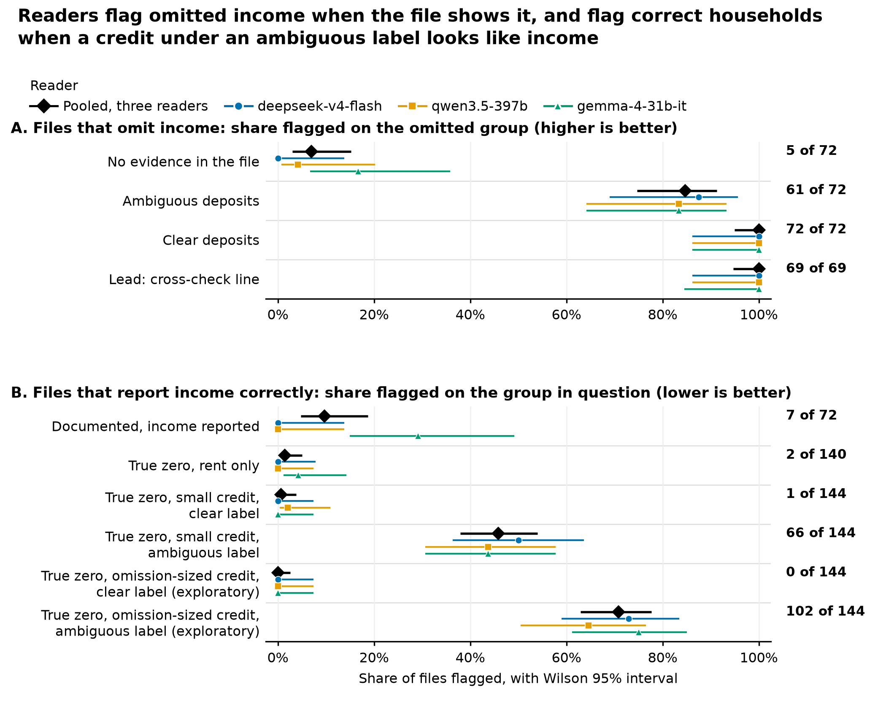

## Abstract

Starting in October 2027, the 2025 federal budget law requires states to pay a share of Supplemental Nutrition Assistance Program (SNAP) benefit costs if their payment error rates are 6% or higher. In FY2024, 44 states met or exceeded 6%. Some states could owe hundreds of millions or billions a year. Michigan has deployed an AI reader to review cases before payment. Exploratory tests show AI agents are capable of filling out SNAP applications. Existing cost simulations assume what an AI reader flags; we measure part of that assumption in two studies with three open-weight LLMs on synthetic case files rebuilt from FY2024 Quality Control households. An AI filer completes applications, and an AI reader reviews files. First, filers invented no income at first filing. Yet a form that required a number turned missing wages into $0 for all twelve households, letting those filings pass rule-based checks. A form that allowed "unknown" kept the gap visible, though one model's filings all failed schema validation. When the portal rejected the required-number form, one model invented wages. Second, AI readers flagged omitted income in all 72 filings that held a clearly labeled deposit, but in 5 of 72 when the file held no trace of it. They also flagged about half the households that truthfully reported no income once a small credit carried an ambiguous label. Readers respond to the cues the file holds, so when AI works on both sides, form design decides what the file records.

---

## 1. Introduction

Consider a household applying to the Supplemental Nutrition Assistance Program (SNAP) whose application note names an employer, yet whose case file holds no pay stub and no payroll deposit. An AI filer acting for the applicant must still complete the monthly wage line. On a required-number form, the filer enters $0—indistinguishable from a truthful zero—and that $0 passes a deterministic rule-based check that flags explicit gaps and unsupported non-zero amounts. On a form allowing "unknown", the filer records an explicit gap that the same check flags. Downstream, an agency's AI reader sees only the submitted case file, so whether it flags an omitted wage depends on what cues remain (Figure 1).

Catching omitted income matters because federal law ties SNAP payment accuracy to state budgets. From October 2027, states with a payment error rate at or above 6% must pay part of benefit costs (Public Law 119-21, 2025). In FY2024, 44 states met or exceeded 6% against a 10.93% national average measuring eligibility and benefit accuracy (USDA FNS, 2025), and a state could face hundreds of millions of dollars annually (Chohlas-Wood, 2026). Michigan already runs an AI reader before payment (Davidson, 2026), while commercial AI agents can attempt online SNAP applications (Solomon and Williams, 2026), so an AI reader may review a file written by an AI filer.

Client-withheld income poses the hardest test for file-only review. In our calculation from FY2024 Quality Control (QC) data (Leftin et al., 2026), client-withheld income makes up 22.35% of weighted error dollars, yet auditors found only 8.50% of those dollars in the case record, versus 59.62% for agency-caused errors. Because $0 is a valid wage for no-income households, neither a rule-based check nor an AI reader can separate truth from missing evidence in a numeric field alone. Prior work studies review and answering separately (Section 2): simulations stipulate reader flags and assume withheld income leaves no trace (Chohlas-Wood, 2026), while missing-evidence work covers unanswerable prompts (Usman, 2026), single-turn adjudication (Afane et al., 2026), and exploratory SNAP applications (Solomon and Williams, 2026)—none testing valid-$0 forms, rejection turns, and downstream review together. We therefore ask: when AI agents file SNAP applications, what can an agency's AI reader catch?

We answer with two separate studies of three open-weight large language models (LLMs) on synthetic case files rebuilt from real FY2024 QC households (Section 3). A filer study tests the wage line across four evidence states, two forms (required number versus "unknown" allowed), and a scripted rejection; a reader study varies file evidence on numeric applications. The studies meet at the file, with no filer output passed to a reader. Across both, readers follow the cues in the file rather than hidden income, and the intake form decides whether our opening household leaves an unflagged $0 or a visible gap (Section 4). Our main contributions are:

1. **Form design governs whether missing wages stay visible (Section 4.1).** Across 12 households, filers invented no wages on first filing; a required-number form recorded missing wages as $0 in 72 of 72 filings (0 flagged by the rule-based check), whereas allowing "unknown" kept all 72 flagged by that check (though one model's filings on that form all failed schema validation). A stale pay-stub figure passed in all 144 filings, and a portal rejection led one model to invent wages in 13 of 24 required-form refilings.
2. **AI readers follow file cues rather than underlying income (Section 4.2).** Three readers flagged omitted income in 72 of 72 reader-file pairs with a clear deposit, 61 of 72 with an ambiguous deposit, and 5 of 72 with none, yet flagged 66 of 144 readings of households that correctly reported no income (45.8%) under an ambiguous small credit versus 1 of 144 (0.7%) under a clear label.
3. **A QC-grounded testbed and study artifacts (Section 3).** We provide synthetic case files rebuilt from audited FY2024 QC records alongside a hidden ground-truth ledger, our deterministic rule-based check, study protocols, and logged model calls.

## 2. Related Work

Prior work studies answering under missing evidence and AI case review separately (Table 1). On the answering side, required fields drive fabrication to 100% in ten of thirteen models, and all nine open-weight models still fabricate in 60 to 100% of trials despite an "insufficient evidence" option (Usman, 2026). Standard prompting averages 15% accuracy on withheld-fact adjudication unless a framework requires naming missing information first (Afane et al., 2026), and two commercial AI agents asked to fill out online SNAP applications guessed when information was not provided (Solomon and Williams, 2026). None describes a follow-up turn; we study a numeric wage field where $0 is also a legitimate answer, followed by a scripted portal rejection. On the review side, risk-based review alone costs about seven times as much in simulation as combining risk scores with AI flags under main assumptions (Chohlas-Wood, 2026), while caseworker accuracy rises with simulated chatbot accuracy (Gosciak et al., 2026). Yet Chohlas-Wood (2026) assumes 80% flag probability on detectable errors, 80% valid flags, and undetectable unreported income in its main scenario, calling whether AI can find these errors reliably an open question. In the same public data, Better Government Lab (2026) observes that variables such as the ratio of shelter expenses to gross income proxy for missing information, and the article on Michigan's deployed pre-payment AI case reader does not describe how it treats missing information (Davidson, 2026). None of these works measures both ends on the same households; in two separate studies on SNAP households rebuilt from FY2024 Quality Control records, we measure what an AI filer records and what an AI reader flags as the file holds more or less evidence.

| Work | What it measures | Input | Benefit application form | Follow-up turn | Case file scored |
|---|---|---|---|---|---|
| Chohlas-Wood (2026) | Cost of review with simulated AI flags | Public QC records | No | No | No (flags simulated) |
| Usman (2026) | Fabrication under required fields | Posts and tickets built to be unanswerable | No | None described | No (scores filled fields) |
| Afane et al. (2026) | Deferral when facts are withheld | Colorado unemployment-insurance cases with facts withheld | No | No (interactive use not tested) | No |
| Solomon and Williams (2026) | Agent behavior on SNAP applications | Two states' online applications | Yes | None described | No (exploratory, not reproducible) |
| Gosciak et al. (2026) | Caseworker accuracy with simulated chatbot advice | 45-question assessments from a 770-question benchmark | No | No | No |
| This paper | What a filer records and what a reader flags | SNAP households rebuilt from QC records | Yes (two forms) | Yes (one scripted rejection) | Yes |

## 3. Methods

### 3.1 Case files
Figure 1 follows one household down a path on which an AI filer completes the application and an AI reader at the agency reviews it against the file. The two studies take the two ends of that path and meet at the file; no filer's application is passed to a reader (Table 2). Both build their files from the FY2024 SNAP Quality Control (QC) public-use file, which records audited dollar amounts and error codes for 44,891 households and no documents (Leftin et al., 2026). For the 44,296 households whose benefit our calculator reproduces to within $1, code generates pay stubs, bank transactions, a lease, utility bills and an applicant note from the verified amounts, and a hidden ledger scores each run. We chose synthetic files because an absence can be scored only if its presence is recorded somewhere, and real files are private; Usman (2026) likewise builds inputs that cannot be answered. Filer and reader receive identical text for a household.

**Table 2: The two studies at a glance.** Both studies use the same three open-weight models, temperature 0 and two repeats; the filer study varies the form and the evidence for one wage line, and the reader study varies the evidence for one income group. The bounds in the last row are fixed before any call.

| | Filer study | Reader study |
|---|---|---|
| Question | What does a filer write on a wage line the file cannot support? | What does a reader flag as the evidence in the file varies? |
| Households | 12 wage-only households, drawn at random from 8,921 | 144: 24 omission, 24 truthful documented, 48 true zero with rent, 48 true zero with one small credit |
| Files | 48 (12 households x 4 evidence states) | 264 (omission 24 x 4 evidence states = 96; truthful documented 24; true zero with rent 48; true zero with a small credit 48 x 2 labels = 96) |
| What varies | Evidence state of the wage line: none, net deposits, stale stub, note amount. Form: required (number required) or provenance ("unknown" allowed, with source tags) | Evidence state of the omitted group: none, ambiguous deposits, clear deposits, lead. Label of a small credit: clear or ambiguous |
| Models | deepseek-v4-flash, qwen3.5-397b, gemma-4-31b-it | the same three readers |
| Calls | 576 first filings (48 files x 2 forms x 3 models x 2 repeats) and 160 refilings after a scripted portal rejection | 1,584 (264 files x 3 readers x 2 repeats); repeat 1 is primary |
| Outcome | Wage line classed as unknown, $0, stated, derived or invented; rule-based check flags or passes the filing | Flags (income group, confidence, reason); a flag counts if it names the income group in question |
| Added afterwards (exploratory) | none | three more readers; an amount arm with a clear-label twin (144 calls each) |
| Pre-specified bounds | (1) invented wages in at most 5% of numeric first filings; (2) at no evidence, the required form writes $0 in at least 90% of filings and the provenance form writes "unknown" in at least 80%; (3) a stale-stub filing copies the stub in at least 90%, and a provenance line tags it as retrieved from a record in at least 90% | (1) at no evidence, the 95% interval of hit rate on omissions minus false-flag rate on true zeros with rent includes 0, per reader; (2) hit rate with a lead of at least 90%, per reader; (3) at least two of three readers flag at least 20% of small-credit true zeros under the ambiguous label on either income group |

### 3.2 Filer study
The filer study asked what an AI filer writes on a wage line that the file cannot support. We drew 12 wage-only households at random from the 8,921 that qualify; all 12 have one employer. An open-weight model read the applicant's note and the file's documents and submitted the application in one function call. We varied two things. The evidence state of the wage line was *none* (the note names the employer; no stub, no payroll deposit), *net deposits* (payroll deposits of net pay only), *stale stub* (one stub dated months before the bank window, at 0.60 of the true wage) or *note amount* (the note gives the wage to the nearest $50). The *required form* needs a number in every money field. The *provenance form* accepts a number or "unknown" and asks for a source and document IDs. As in Usman (2026), the documents stayed identical and only the answer format changed; because the forms differ in two features, we attribute a difference between them to neither alone.

Three models (deepseek-v4-flash, qwen3.5-397b, gemma-4-31b-it) ran at temperature 0 with two repeats, giving 576 first filings. To test whether an abstention survives pressure, a scripted portal rejection stated that a wage amount was required whenever the earned amount was $0, missing or "unknown", and the filer refiled (160 refilings). We classed each wage line as *unknown*, *$0*, *stated* (the note's amount), *derived* (copied or computed from a document, but not the verified wage) or *invented* (in no document).

### 3.3 Rule-based check
The rule-based check compares an application with the file's documents. It flags an income group that the application touches with no supporting document, and a group whose documented amount would change the benefit by more than the $56 QC tolerance. A $0 with no document is out of scope and passes, because $0 is a legitimate answer for a household without wages.

### 3.4 Reader study
The reader study asked what an AI reader flags as the evidence in the file varies. We built 144 households: 24 omissions, 24 truthful documented households, 48 true zeros with rent and 48 true zeros with one small credit. An omission is an income group filed at $2 or less whose verified amount is above $0, and its file holds one of four evidence states: *none*; *clear deposits* (bank credits with their original labels, such as a payroll deposit from the employer); *ambiguous deposits* (the same credits relabeled "ACH CREDIT ELECTRONIC DEPOSIT"); or *lead* (the none file plus one line saying the agency's cross-check shows income, a positive control). The small credit is a transfer from the household's own savings, shown under a clear or an ambiguous label; we call a line that looks like income and is not a *cue*. The reader sees whole dollars and never "unknown", so every group left blank reads $0, as a required form would leave it. It returns flags in one forced tool call, each with an income group, a confidence from 0 to 1 and a reason.

The same three models ran at temperature 0 with two repeats (1,584 calls); repeat 1 is primary. A flag counts only if it names the income group in question. Counts are reader-file pairs, so 24 omission files read by three readers make 72, and the 11 invalid outputs are left out of the denominators.

### 3.5 Pre-specification, additions and earlier runs
Before any call we fixed three hypotheses for each study, each with a numeric bound; Section 4 states each bound beside its result. Three more readers (glm-5.3-flash, gemma-4-26b-a4b-it, qwen3.8-27b), an amount arm that raises the small credit to an omission-sized amount with a clear-label twin, and a confidence analysis were added afterwards and are labeled exploratory or post hoc. A first reader run showed readers treating "not provided" as $0 and one negative file identical to its omission, so we rebuilt the controls. A 2,048-token output cap would have cut about one pilot call in six, so every run uses 8,192. Headline numbers come only from the pre-specified runs, and the code, inputs and logged calls are released.

## 4. Results

### 4.1 The form decides what the filer records
With no wage evidence, every filing on the required form wrote $0 and every filing on the provenance form wrote "unknown" (72 of 72 first filings each; Table 3), well above the pre-specified bounds of 90% and 80% for every model. No filer invented a wage on a first filing (0 of 210 numeric filings in repeat 1, 0 of 206 in repeat 2; the bound was 5%). The rule-based check flagged all 72 "unknown" filings and none of the 72 $0 filings, so the required form turned the same gap into a filing that passes. These counts include gemma-4-31b-it's provenance filings, all of which failed schema validation (96 of 96; deepseek-v4-flash 21 of 96), because invalid filings stay in every denominator.

**Table 3: What the wage line records on first filing and after a portal rejection, by evidence state and form.** Each row has 72 first filings (12 households x 3 models x 2 repeats). The required form turns a missing wage into $0 and the rule-based check passes it; the provenance form keeps it as "unknown" and the check flags it. A supported number passes the check even when it is stale, and no first filing invents a wage. Refilings follow a scripted portal rejection that asks for a wage amount whenever a first filing is $0, missing or "unknown"; only the required form at no evidence produces invented wages, all from qwen3.5-397b (13 of its 24 refilings). Invalid filings failed schema validation and stay in every count.

| Evidence state | Form | First filing: wage line | Failed schema validation | Flagged by rule-based check | Refilings after rejection: wage line | Refilings flagged |
|---|---|---|---:|---:|---|---:|
| None | Required | $0: 72 | 1 | 0 of 72 | $0: 58; invented: 13; invalid output: 1 (72 refilings) | 13 of 71 |
| None | Provenance | unknown: 72 | 31 | 72 of 72 | unknown: 72 (72 refilings) | 72 of 72 |
| Net deposits | Required | derived: 72 | 1 | 72 of 72 | no refiling | n/a |
| Net deposits | Provenance | derived: 56; unknown: 16 | 30 | 72 of 72 | derived: 16 (16 refilings) | 16 of 16 |
| Stale stub | Required | derived: 72 | 1 | 0 of 72 | no refiling | n/a |
| Stale stub | Provenance | derived: 72 | 29 | 0 of 72 | no refiling | n/a |
| Note amount | Required | stated: 72 | 0 | 72 of 72 | no refiling | n/a |
| Note amount | Provenance | stated: 72 | 27 | 72 of 72 | no refiling | n/a |

A supported number passes the check even when it is old. All 144 stale-stub filings copied the stub (the bound was 90%), every provenance line tagged the figure as retrieved from a record, and none was flagged. The check flagged all 288 net-deposit and note-amount filings, because neither a deposit nor a note counts as a wage document. It sees what no document supports, and it cannot see that a supported number is stale.

A rejection can undo an abstention. After the portal asked for a wage, qwen3.5-397b on the required form refiled with an invented wage in 13 of 24 cases at no evidence ($1,200 to $3,096), and the invented wage changed the computed benefit in 10 of the 13 (by more than the $56 tolerance in 9). deepseek-v4-flash and gemma-4-31b-it kept $0 (23 and 24 of 24), and every provenance refiling at no evidence kept "unknown" (72 of 72). Where only net deposits were available, every refiled "unknown" became a wage derived from the deposits (16 of 16). This turn had no pre-specified hypothesis and rests on one model and 12 households.

### 4.2 Readers follow the cues in the file
Readers flagged omitted income when the file showed it and rarely when it did not (Figure 2). Pooled over the three readers, the target group was flagged in 5 of 72 omission files with no evidence, 61 of 72 with ambiguous deposits, 72 of 72 with clear deposits and 69 of 69 valid files with a lead, which met the pre-specified bound of 90% for every reader. With nothing in the file, no reader's hit rate on omissions separated from its false-flag rate on true zeros with rent, as pre-specified, so readers could not tell an omission from an honest zero.

**Figure 2: Readers flag omitted income when the file shows it, and flag correct households when a credit under an ambiguous label looks like income.** Each marker is one reader's share of files flagged on the group in question (first of two repeats; invalid outputs left out), with its Wilson 95% interval; the black diamond pools the three readers, and its count is printed at right. Panel A: files that omit one income group, by what the file shows of it (a lead is one line saying the agency's cross-check shows income). Panel B: files that report every income group correctly, where a true zero is a group whose verified amount is $0; a small credit is a transfer of $40.90 to $219.38 from the household's own savings, and an omission-sized credit is the same transfer raised to $300.89 to $3,581.46. One reader, gemma-4-31b-it, also flags 7 of its 24 truthful documented files; the other two flag none.

Misleading cues drew false flags on honest households. A small credit under the ambiguous label drew a target-group false flag in 66 of 144 true-zero files (45.8%), against 1 of 144 under the clear label, and every reader flagged at least 20% of these households on either income group, which met the pre-specified bound of two of three readers. Raising the credit to an omission-sized amount under the ambiguous label raised false flags to 102 of 144 (70.8%), close to the 84.7% hit rate on omissions with ambiguous deposits, while the same amounts under the clear label drew none (0 of 144); on truthful documented files, gemma-4-31b-it flagged 7 of 24 and the other two readers flagged 0 of 24 each. The label decides whether a credit looks like income, and the amount decides how often. The three added readers show the same direction (27 of 45, 22 of 48 and 5 of 48 files under the ambiguous label, against 3 of 47, 6 of 47 and 1 of 48 under the clear label; exploratory). Confidence followed the cue more than the income: among flagged files it was higher for omissions with ambiguous deposits than for small stray credits (mean 0.85 against 0.61), and the gap narrowed at omission-sized amounts (post hoc).

### 4.3 The studies meet at the file
The $0 that the required form wrote at no evidence matches the application a reader receives for an omission with no evidence, and readers flagged 5 of 72 such files. No reader saw an "unknown", so the effect of the provenance form is measured against the rule-based check alone. The two repeats agreed on the target flag in at least 87.5% of files in every reader cell. Twelve filer households do not separate the three models: every filer hypothesis held for every model, and 12 of 12 bounds a rate no lower than 0.76 (Wilson 95% interval).

## 5. Discussion and Limitations

Each stage of the pipeline certified the record it was handed. A required-number form turned a missing wage into a $0 that a rule-based check cannot tell from a true zero. A source tag recorded where a stale pay-stub figure came from, not whether it was current, and the figure passed the check in all 144 filings. A bank label told readers whether to treat a credit as income. Readers followed these cues rather than the income itself: they flagged omitted income in 72 of 72 files with a clear deposit and in 5 of 72 with none, and they flagged the income group on 66 of 144 readings of households that correctly reported no income once a small credit carried an ambiguous label. The levers an agency controls sit upstream of the model: allow "unknown" on income lines, treat a $0 beside a named employer as a question, answer a rejection with a handoff rather than a demand for a number, and normalize bank labels before review. Cost simulations that assume an AI reader flags 80% of detectable errors treat as a constant a rate that here ran from 5 of 72 to 72 of 72 with the contents of the file.

### Limitations

The two studies ran separately. No filer's application was given to a reader and no reader saw an "unknown", so the form's effect on review is shown for the rule-based check only; if readers treat "unknown" like $0 the advantage disappears at the reader, and if they use it the advantage grows. The case files are synthetic: our generator wrote every document and label, and QC-verified amounts stand as the truth, so the rates describe this testbed and the omissions QC found, and the ordering of evidence states is the result that should carry over. The samples are small (12 filer households; 24 omission households), cover three open-weight models at temperature 0 with one instruction per form, one wage line and a cooperative applicant, and did not separate the models. The two forms differ in two features (an "unknown" option and source tags), and the label effect is not separated from recurrence. The budget-gap and confidence results are post hoc. Appendix part (a) lists the full set of assumptions and how each would change the interpretation if it failed.

### Future Work

I propose 

## 6. Conclusion

We asked what an agency's AI reader can catch when an AI agent fills the SNAP application, using three open-weight models on synthetic case files rebuilt from real FY2024 Quality Control households. A form that required a number turned missing wages into $0 for all twelve households, which a rule-based check passes; a form that allowed "unknown" kept the gap visible to that check. Readers flagged omitted income beside a clear deposit and rarely without one, and an ambiguous deposit label drew false flags on households that correctly reported no income.

Review follows the file, and the form decides what the file records. An agency can change its intake form without changing its model; whether a reader can use an "unknown" is the next test.

## Code and Data

**Code repository:** https://github.com/PrayashJoshi/auditing-ai-snap

The repository holds the seven notebooks (`notebooks/`, numbered 01 to 07, each with an executed `.ipynb`), the result tables and figures for each (`results/`), the experiment runners, inputs and notes (`experiments/`), the benefit calculator, rule rebuilds, packet builders and model client (`src/snapqc/`), and the raw model calls as JSONL files under `experiments/` (39 files). Model calls are made by the runners in `experiments/`. The notebooks read the committed JSONL files and make no calls themselves (`README.md`).

**Data:** The case files are rebuilt from the FY2024 SNAP Quality Control (QC) public-use file, published at https://snapqcdata.net/datafiles and prepared by Mathematica for the USDA Food and Nutrition Administration. The technical documentation is Leftin et al. (2026). The raw files are not committed. `data/fetch.sh` downloads them into `data/raw/`, and `data/SHA256SUMS` lists the checksums. Two other inputs are also not committed: the risk-score data frame from the `snap_qc` repository of the Better Government Lab (`github.com/giannella/snap_qc`, commit c9b2e7f226ef8b09bf70d60371f9916b827b9416), and a Michigan application form (MDHHS-1171, Rev. 10-26) downloaded by hand.

**Case files are synthetic.** Code builds each case file from a QC household's verified amounts. Every document in it (pay stub, bank line, lease, utility bill, note) is generated by `src/snapqc/packets.py` and `src/snapqc/evidence_states.py`. The public-use file has no case documents (Leftin et al., 2026), so the repository contains no applicant record.

**Information hazard:** The findings describe which features of a case file change what a reader flags, and Appendix part (b) discusses how that could be misused. The repository contains no applicant documents. It refers to households by their row index in the public-use file.

## Author Contributions

Prayash Joshi is the sole author. He designed both studies, ran the experiments and wrote the report.

## References

1. Afane, M., Robitschek, E., Ouyang, D., and Ho, D. E. (2026). Learning When Not to Decide: A Framework for Overcoming Factual Presumptuousness in AI Adjudication. In *Proceedings of the Twenty-First International Conference on Artificial Intelligence and Law (ICAIL '26)*, Singapore, June 2026. ACM. arXiv:2604.19895. DOI: [GAP: DOI; the local copy shows a placeholder].
2. Chohlas-Wood, A. (2026). Reducing SNAP Payment Errors at Lower Cost With AI: A Simulation Study. arXiv preprint, arXiv:2611.03213.
3. Davidson, K. (2026). Michigan's use of AI to process SNAP applications draws concerns about past automation failures. Michigan Advance, republished by Route Fifty, March 2026. https://www.route-fifty.com/artificial-intelligence/2026/03/michigans-use-ai-process-snap-applications-draws-concerns-about-past-automation-failures/412395/
4. Leftin, J., Monkovic, M., Yang, F., Bonelli, S., and Maula, J. C. (2026). *Technical Documentation for the Fiscal Year 2024 Supplemental Nutrition Assistance Program Quality Control Database and the QC Minimodel*. Final report. Mathematica, August 2026. URL: [GAP: link].
5. Public Law 119-21 (2025). An Act to provide for reconciliation pursuant to title II of H. Con. Res. 14 (H.R. 1, 119th Congress). Enacted 4 July 2025; 139 Stat. 72. U.S. Government Publishing Office. https://www.govinfo.gov/content/pkg/PLAW-119publ21/html/PLAW-119publ21.htm
6. Solomon, J., and Williams, A. (2026). Can AI Agents Help People Apply for SNAP? (Part 1). Propel, 27 April 2026. https://www.propel.app/insights/can-ai-agents-help-people-apply-for-snap-part-1/
7. U.S. Department of Agriculture, Food and Nutrition Service (2025). USDA Releases Annual SNAP Payment Error Rates for FY 2024. Press release FNS 0003.25, 27 June 2025. https://www.fns.usda.gov/newsroom/fns-0003.25
8. Usman, R. M. (2026). PhantomFill: When the Form Demands an Answer, Language Models Invent One. arXiv:2607.20492v2 [cs.LG], 27 July 2026.

## Appendix: Limitations and Dual-Use / Ethical Considerations

### (a) What the results do and do not establish

- **Synthetic case files.** Assumption: generated documents stand in for real records. If this fails (real records are scanned, misspelled, split across payers and inconsistent in format), the rates describe this testbed and say nothing about real documents.
- **No applicant follow-up.** Assumption: the filer cannot ask the applicant and gets one scripted rejection. If an agent can ask, the filer results show what a filer enters when it cannot ask, and they do not carry over to a filer that can.
- **One income line, twelve households.** Assumption: 12 wage-only households with one wage source each stand in for the income lines a filer fills. If this fails (self-employment, unearned income, several jobs), the results say nothing about those lines, and the per-model intervals are wide.
- **Three open-weight models, one instruction per form, temperature 0.** Assumption: these models under this wording stand for filers and readers. If the wording changed, the model ranking and the size of any form or label effect could change. Repeats measure run-to-run variation, not sensitivity to wording. The filers are not the commercial browser agents that Propel tested.
- **The two forms differ in more than one feature.** Assumption: the abstention-and-provenance form is compared as a bundle. If the "unknown" option alone drives the effect, the source requirement is not what matters. The run that allowed "unknown" without asking for sources has 8 households and is exploratory.
- **QC-verified amounts are true.** Assumption: each reviewer-verified amount is correct. The calculator reproduces the issued benefit within $1 for 44,296 of 44,891 households. If a verified amount is wrong, the filing is scored against the wrong value, and the rates move in a direction the results cannot show.
- **Constructed evidence states and labels.** Assumption: the stale stub (amounts scaled to 0.60 of the original), the net-pay deposits, and the clear and ambiguous labels stand for real evidence. Real bank records mix many labels, amounts and dates. The false-flag rates on ambiguous credits could be higher or lower in real files.
- **A hit at "none" may come from the budget gap.** Assumption: a reader that flags an omission with no evidence in the file is detecting the omission. The file always shows shelter and utility amounts next to reported income. Flagging whenever rent plus simulated bills exceed reported income catches 77 of the 185 omissions (41.6%), and it also fires on 2,120 truthful households with rent alone and 4,015 with simulated bills in the 41 states. If the gap explains the hit, a hit at "none" shows that the reader reads housing costs, not that it detects the omission.
- **Small samples, reused households, a positive control.** Assumption: 24 omission households (12 earned, 12 unearned), shown at every evidence level, stand for omissions. The lead is one added line that works as a positive control, not an agency cross-match. If real cross-match records differ, the hit rate with a lead does not transfer, and per-income-type results cannot be estimated.
- **Readers never see "unknown."** Assumption: turning missing evidence into $0 is what the reader receives. A reader that sees an explicit "unknown" could behave differently, so RQ2 measures what a reader catches after the $0 entry, not after an abstention.
- **No adversarial applicant, no prevalence or cost estimate, text-only documents.** Assumption: the applicant is honest, the reader's inputs are not filer output, and documents are text. The results give no estimate of how many applicants use a filer, how often evidence is missing, or the effect on error rates or on a state's cost share under H.R. 1. Documents submitted as images are not covered.
- **Sprint window.** The sprint ran 13 to 15 November 2026. The filer run covers 12 households and the reader run 24 omission households, which limits what the rates can resolve. The first run of each design was exploratory.

### (b) Dual-use and misuse risk

The results show which features move a reader's flags, and an applicant or a filing vendor could use that to shape a filing. In the pre-specified reader run (repeat 1), a stray own-account credit labelled "ACH CREDIT ELECTRONIC DEPOSIT" drew an income flag on 34 of 48 true-zero households for deepseek-v4-flash, against 0 of 48 under the clear label, and the other two readers showed the same contrast (32 and 38 of 48, against 1 each). In the first reader run the deterministic checker never flagged a $0 omission, but it flagged every "not provided" version of the same omissions, so a $0 entry is the form that passes the rule-based check. A defender would report false-flag rates by label and evidence type next to hit rates, test readers on truthful files written in the same label styles before deployment, and send flags to a human reviewer as a queue rather than treat them as findings.

### (c) Data handling

- **Administrative and personal data.** The only government data handled is the FY2024 QC public-use file, which is not committed. The third-party risk-score frame and the state application form are also not committed. Households are referred to by row index in the public-use file.
- **Synthetic documents.** Case files are generated by code from the verified amounts. Account masks and bank lines are generated, not copied from records.
- **Model calls.** Hosted open-weight models are called through Adaption's Responses API (`src/snapqc/llm.py`) at temperature 0, one forced tool call per request, and every attempt is logged as one JSONL line with its input hash, output, parsed answer, token counts and credit cost. The prompts contain only the synthetic case files.
- **Secrets.** Adaption API keys are read from `.env`, which is git-ignored and not committed.

**Pre-existing versus sprint work.** The repository history starts on 14 November 2026 with a scaffold commit and contains 35 commits through 16 November 2026. Third-party inputs predate the repository: the FY2024 QC public-use file and its technical documentation, the `snap_qc` risk-score frame, the cited papers and statutes, and the hosted models. [GAP: confirm whether any code or design predates 14 November, and whether the 16 November commits belong in the sprint submission.]

# LLM Usage Statement

The author wrote the abstract and the first page (title, teaser figure and its caption), and [AUTHOR: list any other parts you wrote; leave this bracket for the author to fill and do not guess]. The remaining sections were drafted by Claude Code (Anthropic) from the repository's results and notes, using the variant drafts, and were written this way because of the sprint's time limit.

Every number was checked against files under `results/` and `experiments/`, and the author proofread the report and verified the claims and citations before submission.

Claude Code also wrote the notebooks, runners and summary notes in the repository; the open-weight models in the experiments (deepseek-v4-flash, qwen3.5-397b, gemma-4-31b-it) were study subjects, not writing aids; free Gemini models were used as Socratic tutors and produced no text, code or analysis in the report.

The author takes responsibility for every claim. `sprint-log.md` records where AI was used across the sprint.

[^1]: Research conducted at the [AI x Epistemics Research Sprint](https://apartresearch.com/sprints/ai-x-epistemics-research-sprint-2026-11-13-to-2026-11-15), November 2026
